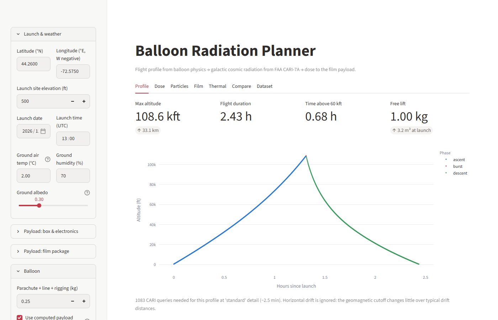
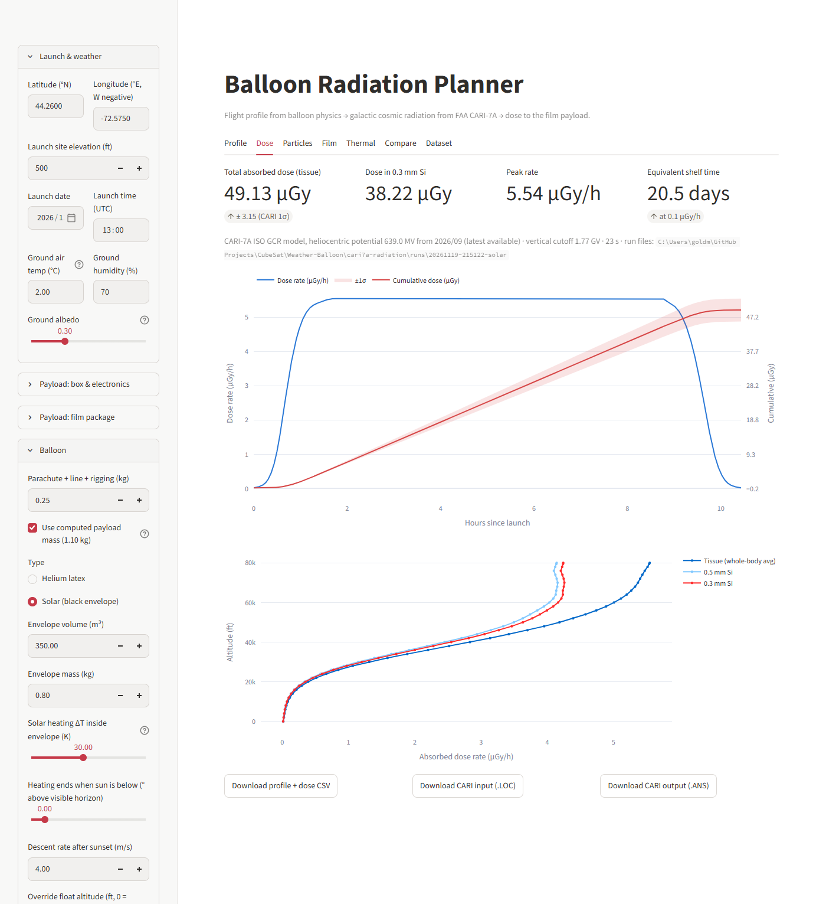
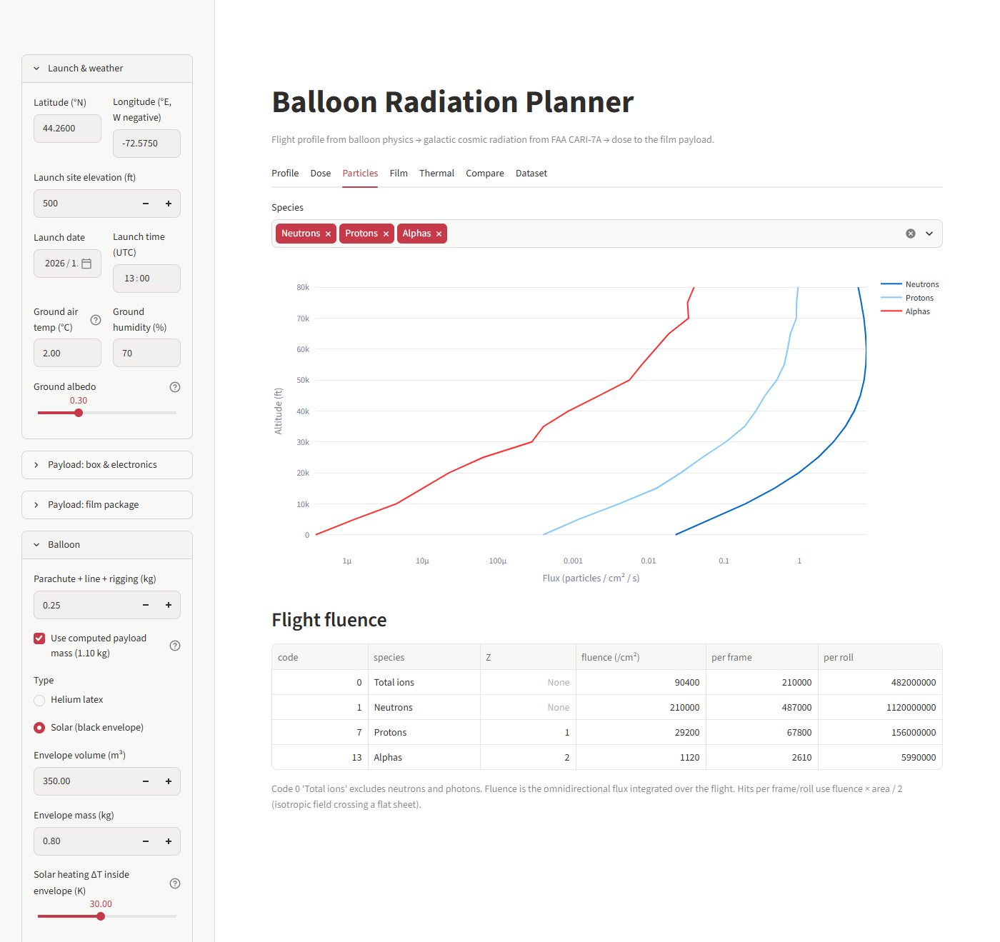
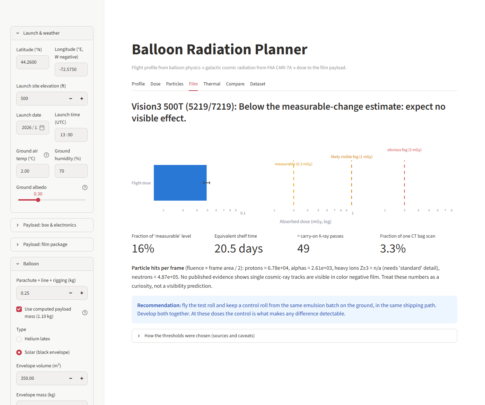
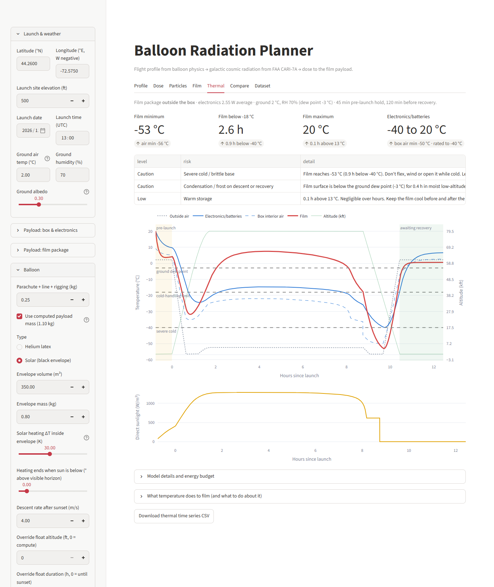
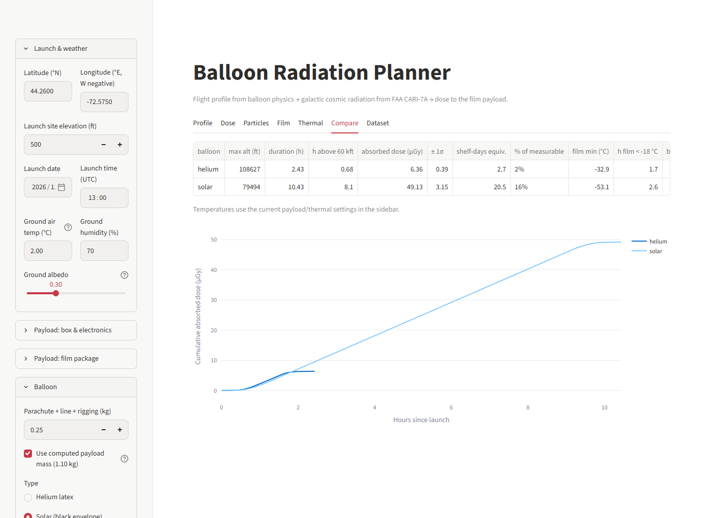
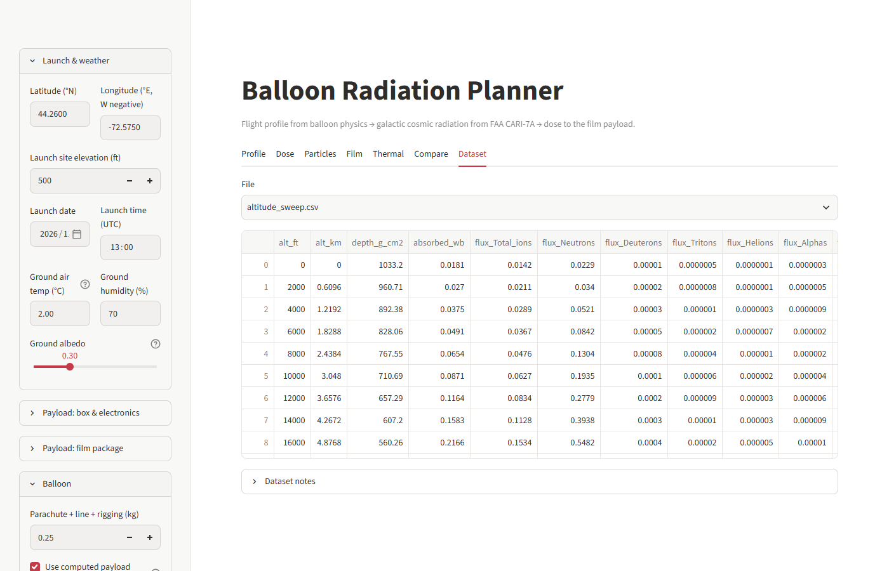

# CARI-7A Balloon Radiation Planner

Estimates the cosmic-radiation dose a payload receives on a weather-balloon flight. It was built to answer one question: *how much radiation will a roll of Kodak Vision3 500T (ECN-2) get on a helium flight compared with a solar-balloon flight?*

Pipeline: **balloon physics → altitude/time profile → FAA CARI-7A (run live) → integrated dose, particle fluence and film-effect estimate.**

The reference results are in [`data/`](data/README.md).

## Setup (Windows)

1. Unpack the CARI-7A distribution. It is ~135 MB, ships as FAA binaries, and is not in git.
2. ```powershell
   cd cari7a-radiation
   python -m venv .venv
   .venv\Scripts\python -m pip install -r requirements.txt
   copy config.example.toml config.toml   # edit cari_dir to point at the folder with CARI-7A.exe
   .venv\Scripts\python -m streamlit run app.py
   ```

On the first run, the needed CARI files are copied into `.cari_work/`. **Your original CARI install is never modified.** Each run's LOC/ANS/control files are archived in `runs/<timestamp>-<tag>/`.

## Using the app

- **Sidebar:** launch site (lat/lon/elevation), date and UTC time, balloon type and parameters, payload shielding, film stock and format, and CARI detail level.
  - **Helium latex:** balloon size (Totex burst-diameter table), payload mass, fill (target ascent rate or neck lift), parachute. Burst altitude is computed and can be overridden.
  - **Solar balloon:** envelope volume and mass, payload, solar heating ΔT. Float altitude comes from buoyancy. Float lasts until the sun sets as seen from float altitude, and float altitude and duration can both be overridden. A sizing helper gives the volume needed for a target altitude.
- **Run CARI-7A** computes rates on an altitude grid (2 kft steps for dose; 5 kft or 2 kft for particle species), then integrates them over the profile. Detail levels and typical run times:
  - **fast:** about 0.5–1 min, doses plus 4 species.
  - **standard:** about 2–3 min, all 37 species.
  - **fine:** about 5 min.
- **Tabs:**
  - **Profile:** the altitude/time profile.
  - **Dose:** rate and cumulative dose with the CARI 1σ band, plus CSV/LOC/ANS downloads.
  - **Thermal:** film and box temperatures and film-handling risks (see below).
  - **Particles:** flux vs altitude and fluence per frame/roll.
  - **Film:** dose vs fog thresholds and equivalents.
  - **Compare:** helium vs solar. Run each type once in the same browser session.
  - **Dataset:** browse the `data/` files.

### Payload, thermal and film-temperature inputs

The sidebar's **Payload** sections describe the real hardware. These values feed the whole app:

| Input | What it affects |
|---|---|
| **Box & electronics:** outer dimensions, wall thickness, foam type (EPS/XPS), exterior finish (bare, white, foil, black); an editable electronics table (DC power drawn from the battery × duty cycle); electronics and battery mass; battery type and energy (Wh); electronics surface area | Thermal model, payload mass |
| **Film package:** preset (100 ft daylight spool in a plastic can, 400 ft core load in a bare or black metal can, 35mm cassette); inside or outside the box; can size, wall, material, surface absorptivity/emissivity; optional insulation wrap | Thermal model, payload mass, radiation shielding |
| **Balloon:** the payload mass is computed from box + film package + rigging unless you untick "Use computed payload mass" | Burst/float altitude and timing |
| **Radiation shielding:** derived from the can wall and insulation, plus the box wall if the film is inside it. Can be entered manually instead | CARI-7A dose |
| **Launch & weather** (ground temperature, humidity, albedo) and **Ground operations** (payload temperature when taken outside, pre-launch hold, wait before recovery, wind) | Thermal model |

The **Thermal** tab doesn't need a CARI run. It simulates the box interior and the film package along the flight, including the ground holds. Its outputs:
- film minimum and maximum temperature, time below the cold limits, and the electronics/battery and box-air temperature ranges
- a risk table: cold/brittle base, static marks if the film is advanced in flight, condensation or frost on descent and recovery, heat, batteries below their rating, and the battery running out
- temperature and sunlight plots, and a CSV export

The model is described in [`thermal.py`](thermal.py). It is a lumped model with sun, albedo, earth/sky infrared and convection:
- **Electronics and batteries** are one node, heated by their DC power until the battery's energy runs out.
- **Box air** sits between the electronics and the foam. Heat reaches it by natural convection, which weakens as √pressure because the box is vented, and by internal infrared.
- **Foam wall:** R = t / kA.

Its accuracy is about ±10–15 °C, so use it to compare designs rather than to predict exact temperatures.

**How much the box keeps the electronics warm** (default 30×25×20 cm EPS box, default flights; minimum electronics temperature):

| DC power | Wall | Helium (~2.4 h) | Solar: at float / night descent |
|---|---|---|---|
| 2.55 W | ½" | −28 °C | −19 / −40 °C |
| 5 W | 1" | −11 °C | −3 / −22 °C |
| 5 W | 2" | +9 °C | +13 / −3 °C |
| 10 W | 1" | +10 °C | +20 / 0 °C |

Two things limit how warm a box stays:
- **The wall is thin.** ½" EPS on this box is about 1.1 K/W, so each watt raises the interior only about 1 °C above the wall. Most of the gap between the electronics and the −56 °C air comes from the sun and the earth's infrared heating the box's outer surface.
- **Battery energy caps the heat.** A 200 g lithium pack (~46 Wh) can supply only about 4 W on average over a 10+ hour solar day.

Comparison with published data:
- **Cooling rate:** the model's cool-down time constant (~35 min for 1" walls) matches a SparkFun freezer test, where a 1" foam box cooled from 25 to 0 °C in about 35 min.
- **Flight minimums:** unheated foam boxes on 2–3 h flights typically reach −10 to −30 °C inside. The Indian Institute of Astrophysics lost a Raspberry Pi to the cold 40 min into a flight ([Safonova et al. 2015](https://arxiv.org/abs/1506.01538)). A sun-heated PET container stayed at −12 °C with −60 °C outside ([Crowe et al., GSBC 2015](https://www.aprs.org/balloons/SolarBalloon-TeamBALU.pdf)).
- **Lumped models:** Embry-Riddle's lumped models (Isenberg et al., AHAC 2012; Meduvsky et al., AHAC 2013) found that the payload's thermal resistance rises at low pressure while its heat capacity doesn't change. This model captures that.

Regenerate the dataset with `.venv\Scripts\python scripts\build_dataset.py` (about 7 minutes; see `--help` for site and date options). Run the tests with `.venv\Scripts\python -m pytest tests`.

## Screenshots

**Profile:** the sidebar inputs and the altitude profile of a 1200 g helium latex balloon.


**Dose:** dose rate, cumulative dose with the CARI 1σ band, and dose rate vs altitude for a solar balloon.


**Particles:** particle flux vs altitude and fluence per frame for the solar flight.


**Film:** the flight dose against the fog thresholds, with everyday equivalents.


**Thermal:** film and box temperatures, film-handling risks and sunlight along the solar flight.


**Compare:** helium and solar flights side by side (one CARI run of each in the same session).


**Dataset:** browsing the precomputed files in `data/`.


Regenerate these with `scripts/take_screenshots.py` while the app is running (see the script's docstring for its separate venv with Playwright).

## Validation

- **Matches your earlier CARI runs.** Running the `VT-BALLOON1` DEG profile through the runner reproduces the earlier CARI output exactly (first step 2.2230E-02 µGy/h whole-body absorbed dose).
- **LOC-grid integration matches CARI's own flight integration.** For that same profile: 7.459 µGy here vs 7.462 µGy from CARI's DEG mode (0.04% difference).
- **Unit tests:**
  - USSA-1976 atmosphere vs tabulated values.
  - Latex burst altitude (≈32 km for 1200 g / 1.5 kg, consistent with the HabHub calculator).
  - Solar float balance and sunset times.
  - LOC line-length limits.
  - Parsers checked against CARI's shipped example outputs.

## What the numbers mean for the film

The thresholds and their sources are documented in [`film.py`](film.py). No published "mGy → fog" figure exists for color negative film, so the thresholds are inferred:

| Level | ISO 500 threshold | Basis |
|---|---|---|
| Measurable change | ~0.3 mGy | About 6 months of ground background |
| Likely visible fog | ~1 mGy | Below one CT checked-bag scan (~1.5 mGy), which visibly fogs film |
| Obvious fog | ~3 mGy | |

The flights give **6–100 µGy, which is 2–33% of the "measurable" level.** That is equivalent to **2–42 days on the shelf** at ground background.

Recommendations:
- **The solar balloon delivers roughly 8–17× the helium dose**, purely because of time aloft. Dose rate is nearly flat from 60 to 120 kft.
- Expect at most a subtle densitometer-level difference, and only for the long solar float.
- **Keep a same-batch control roll on the ground, in the same shipping path,** and develop both rolls together. Ground storage and any X-ray screening can easily exceed the flight dose. Hand-check the film at airports.
- Single heavy-ion tracks: CARI predicts tens to hundreds of Z≥3 hits per frame on a long float. There is no evidence these are visible in color negative film, so treat the count as a curiosity.

## Assumptions and limits

- **Galactic cosmic rays only.** Solar particle events are not included (CARI-7A can model them with a user spectrum). Doses are monthly averages, with no Forbush or Kp adjustment.
- **"Absorbed dose" means CARI's whole-body average for tissue,** used as a proxy for gelatin emulsion. Dose in 0.3/0.5 mm silicon is shown alongside and is about 20% lower.
- **Fixed launch lat/lon (no drift).** The geomagnetic cutoff changes little over typical balloon drift distances.
- **Shielding is approximate,** set through CARI's `VEHICLE.DAT` (Al and HDPE g/cm²). By default it is derived from the film package. Can walls and foam are only about 0.1 g/cm², so they barely change the dose.
- **Balloon models are first-order.**
  - Latex balloons use HabHub-style physics.
  - Solar balloons depend heavily on ΔT (5–60 K slider). Their float time depends on the season: in late November at 44°N it is only about 6.5–7 h of sun at float, so 10–16 h floats need a longer day or a different latitude.
  - For both types, override altitude or duration when you have better numbers.
- **Future months:** for months beyond the CARI heliocentric-potential data (currently ends 2026/09), CARI uses the latest value. The solar-cycle sensitivity file shows the possible range.
